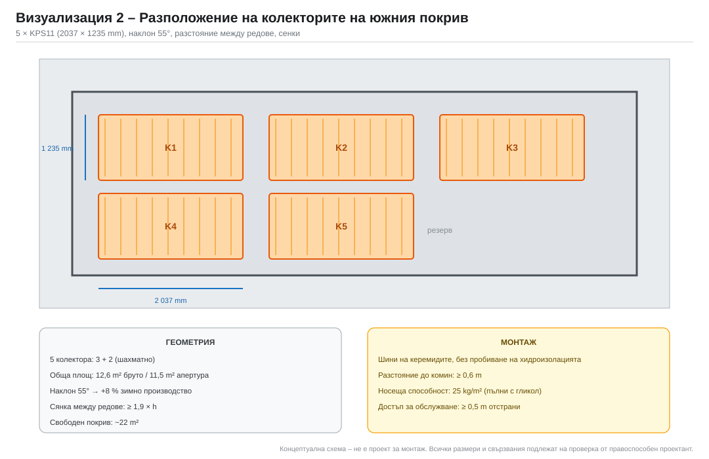

# 5. Избор и оразмеряване на колекторите

## 5.1. Плоски или вакуумно-тръбни?

| Критерий | Плоски (KPS11) | Вакуумно-тръбни (20 тръби) |
|---|---|---|
| Брутна площ на колектор | 2,52 m² | 1,66 m² |
| Апертурна площ | ≈ 2,30 m² | ≈ 1,30 m² |
| Оптичен КПД η₀ | 0,80 | 0,70 |
| Коефициент a₁ | 3,5 W/m²K | 1,6 W/m²K |
| КПД при ΔT = 30 K, G = 800 W/m² | 0,64 | 0,62 |
| КПД при ΔT = 50 K, G = 600 W/m² | 0,49 | 0,55 |
| Специфичен добив (модел) | 503 kWh/m² ап. | 684 kWh/m² ап. |
| Цена за колектор | ≈ 480 € | ≈ 700 € |
| Цена за kWh/год. (соларна част) | **базова** | +45…60 % |
| Тегло | 35 kg | 28 kg |
| Заемана площ за 5 бр. | 12,6 m² | 8,3 m² |
| Риск от прегряване | среден | висок (при стагнация) |
| Подмяна при повреда | цял панел | отделни тръби |

**Извод:** вакуумните колектори имат **по-висок добив на m² апертура**
(+36 %), но са с 45–60 % по-скъпи за същия абсолютен добив. При тази система:
- работната температура е 50–90 °C, а не 90–120 °C, където вакуумните печелят;
- няма недостиг на покривна площ (наличен южен скат ~22 m²);
- цената на kWh е решаваща при вече слабата икономика.

Затова **основният вариант е с плоски колектори**. Вакуумните са резервен
вариант, ако покривната площ е ограничена или ако се предвижда работа при
по-високи температури (например захранване на абсорбционна машина).

## 5.2. Технически данни на избрания колектор

| Параметър | KPS11 |
|---|---|
| Размери (Д × Ш × В) | 2 037 × 1 235 × 90 mm |
| Брутна площ | 2,52 m² |
| Апертурна площ | ≈ 2,30 m² (по каталожни данни) |
| Абсорбер | меден „арфа“, селективно покритие TiNOx |
| Стъкло | закалено, ниско-желязно, 4 mm |
| Обем на течността | 1,7 l |
| Максимална мощност | 1 802 W (при G = 1 000 W/m², ΔT = 10 K) |
| Свързване | 4 × Cu 22 mm |
| Сертификати | Solar Keymark, BAFA |
| Тегло | ≈ 35 kg |

> Стойностите са от публичната страница на производителя
> ([regulus.eu – KPS11](https://www.regulus.eu/en/kps11-solar-collector~42.16278),
> проверено 05.11.2026). Апертурната площ и коефициентите η₀/a₁/a₂ трябва да се
> вземат от **актуалния Solar Keymark сертификат** преди оразмеряване.

## 5.3. Варианти с плоски колектори

Мощност при G = 1 000 W/m² и ΔT = 30 K:  η = 0,68 → **681 W/m² апертура**.

| Показател | 4 бр. | 5 бр. | 6 бр. |
|---|---|---|---|
| Брутна площ | 10,1 m² | 12,6 m² | 15,1 m² |
| Апертурна площ | 9,2 m² | 11,5 m² | 13,8 m² |
| Топлинна мощност при G = 1 000 W/m² | 6,3 kW | 7,8 kW | 9,4 kW |
| Мощност при G = 800 W/m², ΔT = 50 K | 3,9 kW | 4,9 kW | 5,9 kW |
| Дебит (40 l/h·m²) | 368 l/h | 460 l/h | 552 l/h |
| Температурен режим | 50/60 °C | 50/60 °C | 50/60 °C |
| Заемана покривна площ с разстояния | ≈ 16 m² | ≈ 20 m² | ≈ 24 m² |
| Ориентировъчна цена (с ДДС) | 2 832 € | 3 528 € | 4 236 € |

### Варианти – плоски колектори (буфер 800 l)

| Показател | 4 бр. | 5 бр. | 6 бр. |
|---|---|---|---|
| Брутна площ, m² | 10.1 | 12.6 | 15.1 |
| Апертурна площ, m² | 9.2 | 11.5 | 13.8 |
| Годишно производство, kWh | 4973 | 5790 | 6615 |
| Специфично, kWh/m²(ап.) | 540 | 503 | 479 |
| Реално използвано, kWh | 3334 | 3683 | 3953 |
|   – за БГВ, kWh | 1415 | 1377 | 1346 |
|   – за отопление, kWh | 1919 | 2305 | 2607 |
| Излишък (неизползваем), kWh | 458 | 867 | 1379 |
| Остатък от пелети/камина, kWh | 5876 | 5528 | 5257 |
| Слънчев дял от товара | 36% | 40% | 43% |
| Часове работа на соларната помпа | 1435 | 1375 | 1334 |

**Коментар:**
- 4 → 5 колектора: **+349 kWh/год.** използвана енергия (+9,5 %)
- 5 → 6 колектора: **+270 kWh/год.** (+7,3 %)
- Излишъкът нараства от 458 на 1 379 kWh – т.е. шестият колектор работи
  предимно „на покрива“, без полезен товар.

## 5.4. Варианти с вакуумно-тръбни колектори

Допълнителното изчисление е направено със **същия часови модел**
([tools/system_model.py](../tools/system_model.py)), същата сграда, същия буфер
800 l и същите метеоданни (PVGIS 2018–2020). Сменен е само типът на колектора:
20 тръби, 1,66 m² бруто / 1,30 m² апертура, η₀ = 0,70, a₁ = 1,6 W/m²K,
a₂ = 0,008 W/m²K², дебит 50 l/h·m². Таблиците се възпроизвеждат с
[tools/tube_variant.py](../tools/tube_variant.py).

### 5.4.1. Енергиен баланс – вакуумно-тръбни колектори (буфер 800 l)

| Показател | 4 бр. | 5 бр. | 6 бр. |
|---|---|---|---|
| Брутна площ, m² | 6.6 | 8.3 | 10.0 |
| Апертурна площ, m² | 5.2 | 6.5 | 7.8 |
| Годишно производство, kWh | 3753 | 4445 | 5148 |
| Специфично, kWh/m²(ап.) | 722 | 684 | 660 |
| Реално използвано, kWh | 2536 | 2979 | 3339 |
|   – за БГВ, kWh | 1481 | 1508 | 1508 |
|   – за отопление, kWh | 1055 | 1471 | 1832 |
| Излишък (неизползваем), kWh | 184 | 333 | 617 |
| Остатък от пелети/камина, kWh | 6675 | 6232 | 5871 |
| Слънчев дял от товара | 28% | 32% | 36% |
| Часове работа на соларната помпа | 1636 | 1585 | 1546 |

При вакуумните колектори специфичният добив е по-висок, но **абсолютният
използван добив е по-нисък** от плоските при същата цена: 6 вакуумни
(10,0 m² бруто) дават 3 339 kWh, а 5 плоски (12,6 m²) – 3 683 kWh.

### 5.4.2. Допълнително изчисление – 4 до 8 тръбни колектора

| Показател | Плоски 5 бр. | Тръбни 4 | Тръбни 5 | Тръбни 6 | Тръбни 7 | Тръбни 8 |
|---|---|---|---|---|---|---|
| Брутна площ, m² | 12,6 | 6,6 | 8,3 | 10,0 | 11,6 | 13,3 |
| Апертурна площ, m² | 11,5 | 5,2 | 6,5 | 7,8 | 9,1 | 10,4 |
| Годишно производство, kWh | 5 790 | 3 753 | 4 445 | 5 148 | 5 855 | 6 565 |
| Специфично, kWh/m²(ап.) | 503 | 722 | 684 | 660 | 643 | 631 |
| Реално използвано, kWh | 3 683 | 2 536 | 2 979 | 3 339 | 3 614 | 3 846 |
| Слънчев дял от товара | 40 % | 28 % | 32 % | 36 % | 39 % | 42 % |
| Излишък, kWh | 867 | 184 | 333 | 617 | 1 005 | 1 451 |
| Часове в стагнационен прозорец, h/a | 137 | 1 | 46 | 110 | 183 | 247 |
| Макс. температура на абсорбера при стагнация, °C | 168 | 195 | 230 | 244 | 244 | 244 |
| Соларна инвестиция с ДДС, € | 6 153 | 6 569 | 7 643 | 8 537 | 9 611 | 10 505 |
| Спестени разходи, €/a | 281 | 194 | 228 | 255 | 276 | 294 |
| Изплащане на соларната част, г. | 22 | 34 | 34 | 33 | 35 | 36 |
| NPV 20 г. при 4 %, € | −2 330 | −3 936 | −4 551 | −5 071 | −5 859 | −6 512 |
| LCOE, €/kWh | 0,100 | 0,155 | 0,154 | 0,153 | 0,160 | 0,164 |

Допускания за цените: колектор 700 €, монтажна шина 150 € на 2 колектора,
свързващ комплект 45 €, конструкция 250 €, труд +10 % спрямо плоските;
соларната станция, топлообменникът, разширителният съд, гликолът и трудът
(15 %) са както при плоските.

**Какво показва таблицата:**

- Добивът на m² апертура е наистина по-висок (+36 %), но цената на m² бруто е
  **2,2×** по-висока (421 €/m² срещу 190 €/m²), затова цената на спестената
  топлина е 1,5–1,6× по-висока;
- максималният соларен дял, който има смисъл, се достига с **осем** тръбни
  колектора (42 %), т.е. със същия дял като 6 плоски, но с по-голяма брутна
  площ и по-висока цена;
- всеки следващ тръбен колектор след шестия се изплаща за 50–51 години, т.е.
  практически не се изплаща.

### 5.4.3. Колко тръбни колектора дават енергията на 5 плоски

| Брой тръбни | Използвано, kWh | Разлика към 5 плоски | Инвестиция с ДДС, € | Изплащане, г. |
|---|---|---|---|---|
| 4 | 2 536 | −1 147 | 6 569 | 34 |
| 5 | 2 979 | −704 | 7 643 | 34 |
| 6 | 3 339 | −344 | 8 537 | 33 |
| 7 | 3 614 | −69 | 9 611 | 35 |
| 8 | 3 846 | +164 | 10 505 | 36 |

> Еквивалентът на 5 плоски колектора (3 683 kWh/год.) се достига при
> **8 тръбни** (13,3 m² бруто), инвестиция 10 505 € с ДДС – с **+71 %** спрямо
> плоските.

Маргинална цена на всеки следващ тръбен колектор:

| Стъпка | Доп. инвестиция с ДДС, € | Доп. използвана енергия, kWh/a | Доп. спестяване, €/a | Изплащане, г. |
|---|---|---|---|---|
| 4 → 5 | 1 074 | 443 | 34 | 32 |
| 5 → 6 | 894 | 360 | 28 | 32 |
| 6 → 7 | 1 074 | 275 | 21 | 51 |
| 7 → 8 | 894 | 232 | 18 | 50 |

### 5.4.4. Цена на спестената топлина (соларна част, 20 г., 4 %)

| Вариант | Спестена енергия, kWh/a | Инвестиция с ДДС, € | €/kWh(спестен) | Спрямо 5 плоски |
|---|---|---|---|---|
| Плоски 5 | 3 683 | 6 153 | 0,100 | 1,00× |
| Тръбни 4 | 2 536 | 6 569 | 0,155 | 1,55× |
| Тръбни 5 | 2 979 | 7 643 | 0,154 | 1,54× |
| Тръбни 6 | 3 339 | 8 537 | 0,153 | 1,53× |
| Тръбни 7 | 3 614 | 9 611 | 0,160 | 1,59× |
| Тръбни 8 | 3 846 | 10 505 | 0,164 | 1,63× |

### 5.4.5. Чувствителност – цена на един тръбен колектор

| Цена, €/бр. | 5 тръбни: инвестиция, € | 5 тръбни: изплащане, г. | 8 тръбни: инвестиция, € | 8 тръбни: изплащане, г. |
|---|---|---|---|---|
| 350 | 5 543 | 24 | 7 145 | 24 |
| 450 | 6 143 | 27 | 8 105 | 28 |
| 550 | 6 743 | 30 | 9 065 | 31 |
| 700 | 7 643 | 34 | 10 505 | 36 |

> За сравнение: 5 плоски – 6 153 € с ДДС, изплащане 22 г. **Дори при 350 €
> за тръбен колектор** (най-евтините китайски) изплащането остава 24 години –
> над 22-те години на плоските. Изводът не зависи от ценовата разлика, а от
> физиката: при 50–90 °C работна температура вакуумната изолация не се
> използва, а се плаща.

### 5.4.6. Стагнация – количествена оценка

| Показател | Плоски 5 | Тръбни 5 | Тръбни 8 |
|---|---|---|---|
| Часове с буфер над 90 °C, h/a | 2 530 | 1 317 | 3 061 |
| Дни с буфер над 90 °C, d/a | 141 | 75 | 160 |
| Часове без топлинен приемник, h/a | 137 | 46 | 247 |
| Суха стагнация, изчислена, °C | 168 | 230 | 244 |
| Излишък за разсейване, kWh/a | 867 | 333 | 1 451 |
| Часове работа на помпата, h/a | 1 375 | 1 585 | 1 501 |

„Часове без топлинен приемник“ = часове с G > 300 W/m², в които буферът е
практически пълен – тогава колекторът няма къде да отдаде топлина и работи на
границата на стагнация. Сухата стагнация е изчислена от η₀, a₁ и a₂ при
G = 1 000 W/m² (нулев КПД).

**Коментар:** при 5 тръбни колектора стагнационните часове са по-малко, отколкото
при плоските (46 срещу 137), защото системата произвежда по-малко енергия. Но
когато стагнация настъпи, температурата е **значително по-висока** (230 °C срещу
168 °C) и се разсейва по-бавно. При 8 тръбни (енергийният еквивалент) и двата
показателя са по-лоши от плоските: 247 h и 244 °C. Рисковете и форумните оценки
са разгледани в [11.5](11-експлоатация-и-безопасност.md).

### 5.4.7. Извод

1. Вакуумните тръби печелят **на m² апертура**, но губят **на евро**:
   LCOE 0,153–0,164 €/kWh срещу 0,100 €/kWh при плоските.
2. За същата полезна енергия са нужни **8 тръбни** колектора – с 71 % повече
   инвестиция и 36 години изплащане вместо 22.
3. Няма и печалба в покривна площ: 8 тръбни заемат 13,3 m² бруто срещу
   12,6 m² при 5 плоски (апертурата е по-малка, но рамките и разстоянията – не).
4. Вариантът остава оправдан само при: силно ограничена площ **и** нужда от
   високи температури (абсорбционна машина, технологична топлина), или при
   естетическо изискване на собственика. Тогава минимумът е 6 тръбни.

## 5.5. Избор на брой колектори

| Критерий | 4 бр. | 5 бр. | 6 бр. |
|---|---|---|---|
| Соларен дял | 36 % | 40 % | 43 % |
| Спестени пелети | 772 kg | 853 kg | 915 kg |
| Соларна инвестиция с ДДС | 5 721 € | 6 153 € | 6 585 € |
| Изплащане на соларната част | 22 г. | 22 г. | 22 г. |
| Маргинално изплащане на последния колектор | – | 16 г. | 21 г. |
| Покривна площ | 16 m² | 20 m² | 24 m² |

**Избрано: 5 колектора (12,6 m² бруто, 11,5 m² апертура).**

Обосновка:
1. Петият колектор има приемливо маргинално изплащане (16 години) и вдига
   соларния дял над 40 % – психологически важна граница за собственика.
2. Шестият колектор работи предимно в излишък (1 379 kWh/год. неизползваема
   енергия) и изисква буфер 1 000 l, за да има смисъл.
3. Четири колектора са допустим минимум при бюджетни ограничения; при
   добра изолация на сградата (U_стена ≤ 0,25) те са достатъчни.
4. Покривът трябва да поеме 5 × 2,52 m² + разстояния = **~20 m²** свободна
   южна площ – при налични 22 m² това е границата.

## 5.6. Разположение и монтаж

- 5 колектора в две редици (3 + 2) или един ред от 5 – зависи от геометрията
  на ската;
- наклон 55° (при скат 35–45° се използват стойки, които добавят 10–20°);
- разстояние между редовете: **d ≥ 1,9 × h** (h – височина на колектора),
  за да няма засенчване на 21 декември по обед;
- разстояние до комина ≥ 0,6 m;
- натоварване върху покрива: 35 kg + 1,7 l гликол ≈ **40 kg/m²**;
- всички прониквания през хидроизолацията се уплътняват с EPDM маншети;
- колекторното поле се заземи и свърже към мълниезащитата (ако има такава).

## 5.7. Ориентировъчна цена

| Позиция | 4 бр. | 5 бр. | 6 бр. |
|---|---|---|---|
| Колектори (480 €/бр.) | 1 920 € | 2 400 € | 2 880 € |
| Монтажни шини и анкери | 290 € | 360 € | 430 € |
| Свързващи комплекти | 150 € | 180 € | 220 € |
| **Общо без ДДС** | **2 360 €** | **2 940 €** | **3 530 €** |
| **С ДДС** | **2 832 €** | **3 528 €** | **4 236 €** |

> Цените са пазарни ориентири към 05.11.2026 и подлежат на потвърждение с
> оферти.
