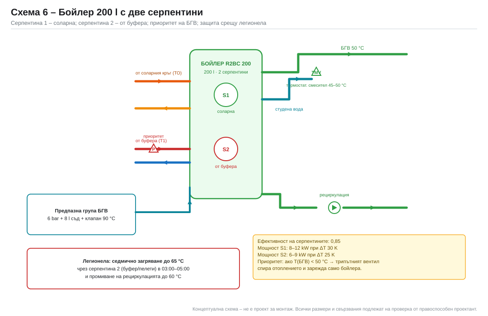

# 6. Буферен съд и бойлер за БГВ

## 6.1. Оразмеряване на буфера

Буферът изпълнява четири функции: съхранение на слънчева енергия,
хидравличен разделител между източниците, акумулатор за камината и
краткотраен резерв при спиране на пелетния уред.

### Критерий 1 – слънчева система

`V = (50…70) l/m² апертура`

`V = 60 × 11,5 = 690 l`

### Критерий 2 – камина с водна риза

Едно зареждане на камината отделя ≈ 24 kWh към водата (12 kW × 2 h).
При допустимо повишаване на температурата с 30 K (от 40 до 70 °C):

`V = Q / (1,163 · ΔT) = 24 000 / (1,163 · 30) = 688 l`

### Критерий 3 – автономия на отоплението

При проектен товар 4,9 kW и полезен обхват 40 → 70 °C:

`Q = 800 × 1,163 × 30 = 27 912 Wh = 27,9 kWh`

`t = 27,9 / 4,9 = 5,7 h` – достатъчно за нощен режим без пускане на пелетите.

### Критерий 4 – пелетен уред

`V = (40…60) l/kW` → при 12 kW: 480–720 l.

### Избор

| Обем | Слънцев дял | Използвано, kWh | Загуби, kWh/год. | Коментар |
|---|---|---|---|---|
| 500 l | долна граница | 3 757 | 480 | недостатъчен за камината |
| **800 l** | **оптимум** | **3 683** | **630** | **избран** |
| 1 000 l | над оптимума | 3 695 | 790 | +77 kWh за +25 % цена |

**Избран обем: 800 l.**

> Забележка: разликата в използваната енергия между 500 и 1 000 l е под 2 % –
> т.е. **обемът почти не влияе на годишния добив** при този малък товар.
> Изборът се определя от камината (≥ 690 l), автономията и стабилността на
> соларния кръг, а не от енергийния добив.

## 6.2. Топлинен капацитет и стратификация

`C = V · ρ · c_p = 800 · 1 · 4,186 = 3 349 kJ/K = 0,93 kWh/K`

| Обхват | Енергия | Автономия при 4,9 kW |
|---|---|---|
| 40 → 60 °C | 18,6 kWh | 3,8 h |
| 40 → 80 °C | 37,2 kWh | 7,6 h |
| 30 → 90 °C | 55,8 kWh | 11,4 h |

**Стратификация:** при добре проектирани входове разликата между горната и
долната част е **15–25 K**. Това позволява:
- соларният кръг да работи при ниска температура (долна част 40–45 °C);
- отоплението да получава 55–60 °C от горната част;
- БГВ да се загрява от най-топлия слой.

Моделът дава следния средномесечен профил:

### Средни температури в буфера (5 плоски, 800 l)

| | Яну | Фев | Мар | Апр | Май | Юни | Юли | Авг | Сеп | Окт | Ное | Дек |
|---|---|---|---|---|---|---|---|---|---|---|---|---|
| Горна част, °C | 57 | 59 | 66 | 79 | 79 | 82 | 87 | 93 | 92 | 85 | 61 | 57 |
| Долна част, °C | 41 | 43 | 50 | 63 | 63 | 66 | 71 | 77 | 76 | 69 | 45 | 41 |

> През лятото (юли–септември) буферът достига 90–93 °C – това е нормално и е
> причината за 867 kWh неизползваем излишък. Мерките срещу прегряване са
> описани в [08](08-автоматика.md).

## 6.3. Входове и изходи (9 шуцера G 6/4")

| № | Връзка | Височина | Забележка |
|---|---|---|---|
| 1 | Соларен кръг – подаване (от ТО) | 1 550 mm | ланцева тръба, за да не разбърква |
| 2 | Камина – подаване | 1 450 mm | |
| 3 | Пелети – подаване | 1 350 mm | |
| 4 | Отопление – подаване | 1 200 mm | към трипътния смесител |
| 5 | Бойлер – серпентина 2 | 1 000 mm | |
| 6 | Соларен кръг – връщане | 200 mm | най-студената зона |
| 7 | Пелети – връщане | 300 mm | |
| 8 | Камина – връщане | 400 mm | |
| 9 | Отопление – връщане | 500 mm | |

Допълнително: дренаж в най-ниската точка, обезвъздушител в най-високата,
3 датчика (T1 – 1 450 mm, T2 – 900 mm, T3 – 250 mm) и 1 резервен шуцер.

## 6.4. Изолация и топлинни загуби

| Параметр | Стойност |
|---|---|
| Дебелина на изолацията | 100 mm (мека, λ = 0,035–0,040 W/m·K) |
| Външна повърхност | ≈ 5,2 m² (цилиндър Ø 0,79 × 1,694 m) |
| U на изолирания съд | ≈ 0,35 W/m²K |
| UA | ≈ 1,8–2,0 W/K |
| Загуби при ΔT = 36 K | 65–72 W → **1,6–1,7 kWh/ден** |
| Годишни загуби | ≈ 630 kWh (6,8 % от товара) |

> Загубите на буфера са реални и са включени в енергийния баланс. Те се
> плащат от слънцето или от пелетите. Затова не се препоръчва буфер над
> 1 000 l без добра изолация.

## 6.5. Конкретен модел

| Параметър | Regulus PS 800 N+ |
|---|---|
| Обем | 800 l |
| Размери | Ø 790 mm × 1 694 mm |
| Връзки | 9 × G 6/4" |
| Топлообменници | няма (външен пластинчат ТО за соларния кръг) |
| Макс. налягане | 3 bar |
| Макс. температура | 95 °C |
| Тегло празен | ≈ 150 kg |
| Цена (ориентир, с изолация) | ≈ 1 250 € |

Източник: [regulus.eu – PS 800 N+](https://www.regulus.eu/en/ps-800-n-thermal-store.15141),
проверено 05.11.2026.

**Защо без вградени серпентини:** соларният кръг се отделя с външен пластинчат
топлообменник. Това дава:
- по-ниска цена на буфера;
- възможност за избор на произволен обем;
- по-лесно обслужване и по-малък обем гликол;
- възможност за бъдещо добавяне на втора серпентина.

Алтернатива: буфер с 1–2 вградени серпентини (друг производител) – спестява
един кръг и помпа, но е с 25–35 % по-скъп.

## 6.6. Бойлер за БГВ – 200 l с две серпентини

### Оразмеряване

Пикова консумация: 4 души, 60 l на човек при 45 °C за 10 минути → 240 l.
Бойлер 200 l при 60 °C, смесен до 45 °C, дава:

`V_45 = 200 × (60 − 10) / (45 − 10) = 286 l`

Това покрива сутрешния пик. При 180 l/ден средна консумация бойлерът работи
в цикъл „загряване – изстиване“ и соларната серпентина успява да го зареди.

### Серпентини

| | Серпентина 1 (соларна) | Серпентина 2 (от буфера) |
|---|---|---|
| Топлоносител | гликол 40 % | вода 55–65 °C |
| Площ | ≈ 1,2 m² | ≈ 1,2 m² |
| Мощност | 8–12 kW при ΔT = 30 K | 6–9 kW при ΔT = 25 K |
| Управление | приоритет при T4 − T8 > 7 K | при T8 < 50 °C и T1 > 55 °C |

### Модел

| Параметър | Regulus R2BC 200 |
|---|---|
| Обем | 200 l |
| Серпентини | 2 |
| Макс. налягане | 10 bar |
| Макс. температура | 95 °C |
| Материал | стомана, емайлирана, с магнезиев анод |
| Цена (ориентир) | ≈ 760 € |

Източник: [regulus.eu – R2BC 200](https://www.regulus.eu/en/r2bc-200-hot-water-storage-tank.6481),
проверено 05.11.2026.

### Защита срещу легионела

- седмична програма: загряване до **65 °C** в 03:00–05:00 (когато няма
  консумация), чрез серпентина 2 (буфер/пелети) или електрически нагревател;
- промиване на рециркулационния кръг до 60 °C за 10 минути;
- при неизпълнение – аларма на контролера.

### Защита срещу изгаряне

Термостатичен смесител на изхода, настроен на **45–50 °C**, с блокировка при
студена вода. Това е задължително при наличие на деца и при температура в
бойлера до 65 °C.

### Схема на свързване

