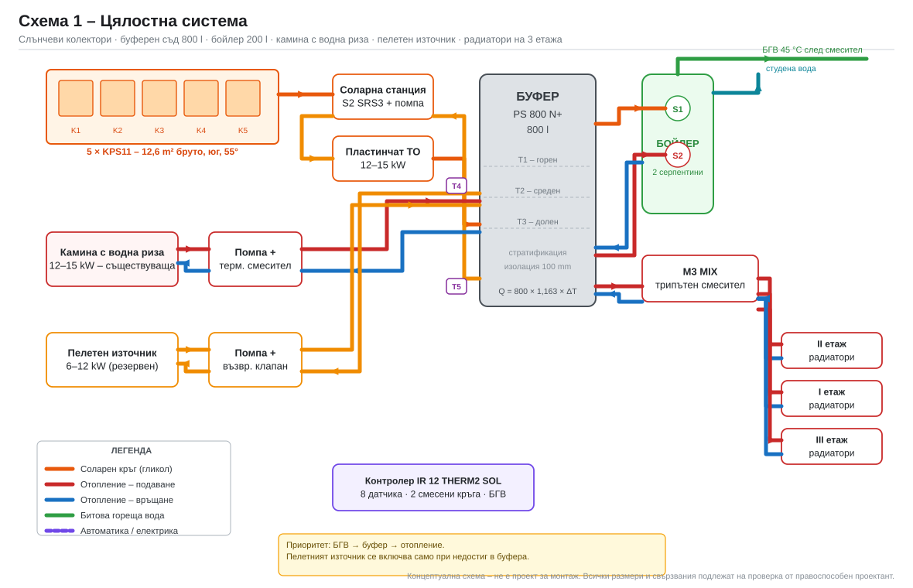
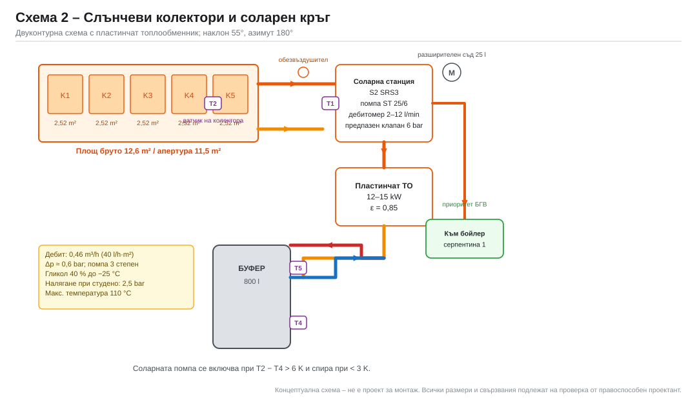
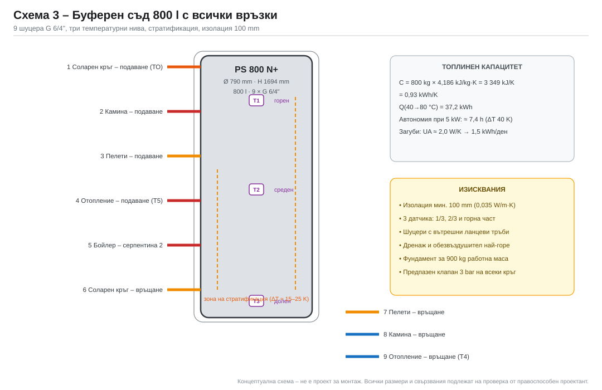
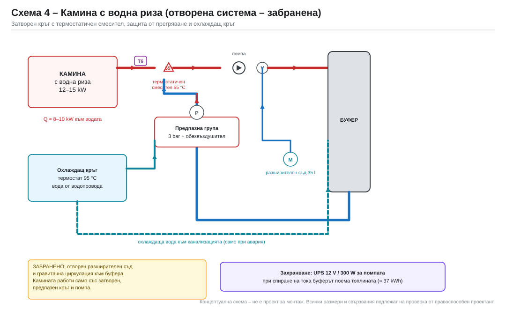
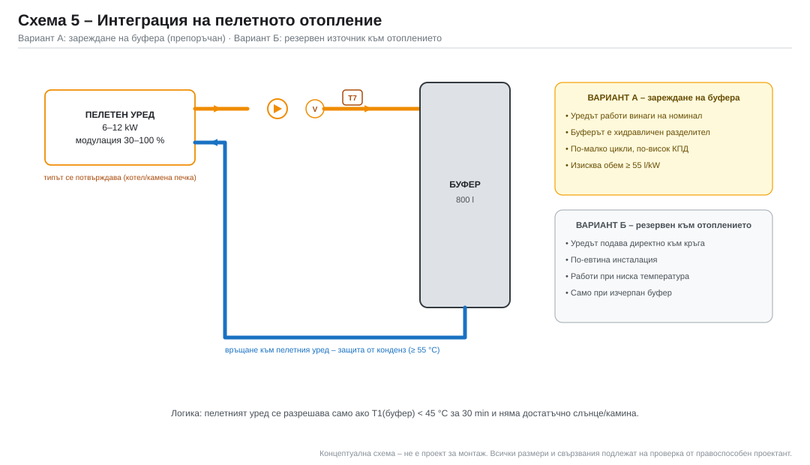
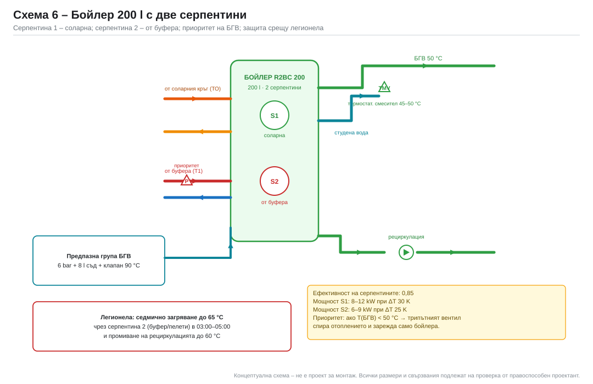
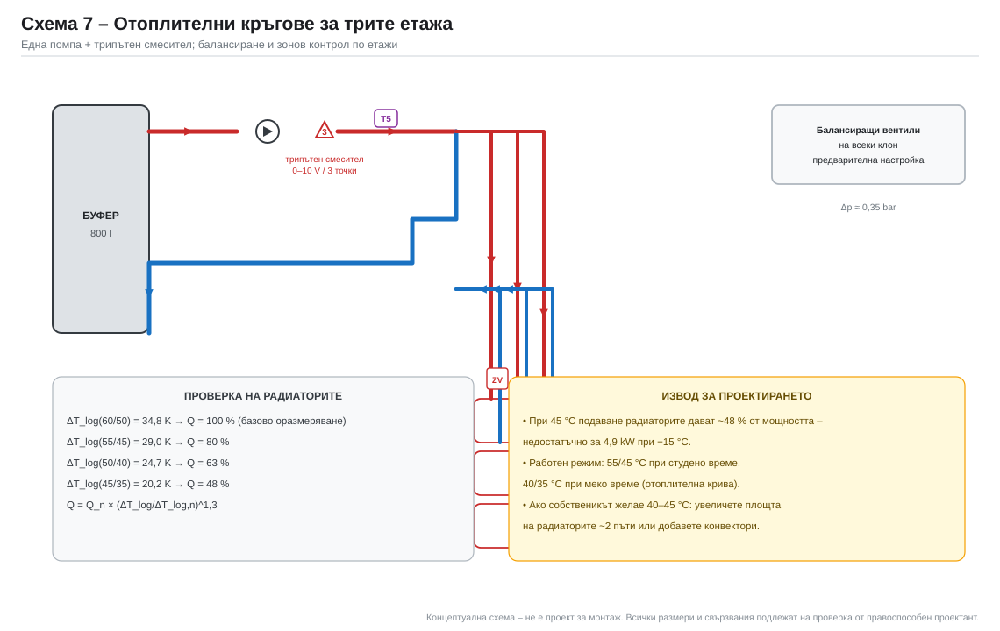
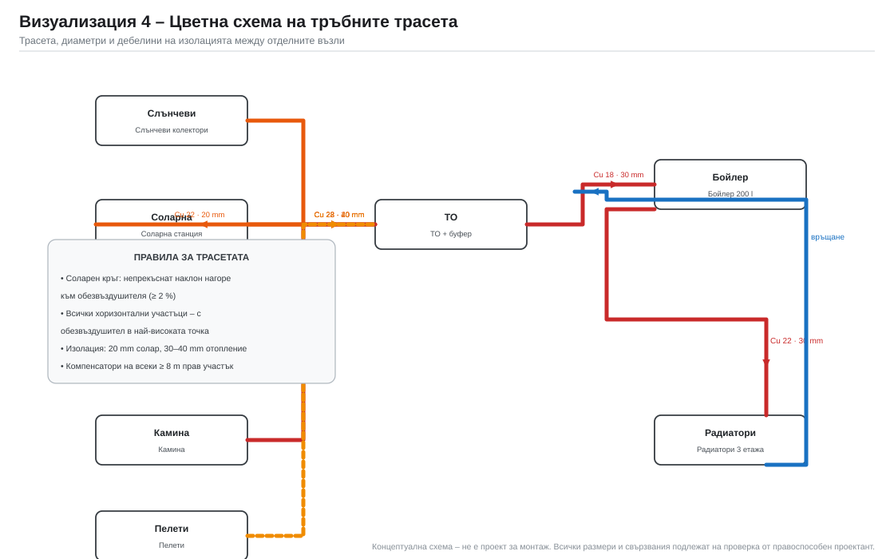

# 7. Хидравлични схеми и оразмеряване

Всички схеми са **концептуални**. Те показват логиката на свързване, но не
заменят монтажен чертеж. Всяка помпа, клапан, датчик и предпазен елемент е
означен с номер/таг, който съвпада с количествената сметка в
[09](09-количествена-сметка-и-цени.md).

## 7.1. Принципна схема на цялата система

**Логика:**
- соларният кръг (оранжев) е **затворен, с гликол**, отделен от буфера с
  пластинчат топлообменник;
- камината и пелетният уред подават **директно** във буфера;
- отоплението взема от горната част на буфера през трипътен смесител;
- БГВ се загрява първо от слънцето (серпентина 1), после от буфера
  (серпентина 2);
- всички източници са паралелни на буфера – буферът е **хидравличен
  разделител**.

## 7.2. Соларен кръг

### Оразмеряване

| Параметър | Изчисление | Стойност |
|---|---|---|
| Дебит | 40 l/h · 11,5 m² | **460 l/h** (0,46 m³/h) |
| Тръба | Cu 22 × 1,0 (вътр. Ø 20 mm) | v = 0,41 m/s |
| Скорост – препоръчителна | 0,3–0,8 m/s | ✔ |
| Загуби в колекторното поле | 5 колектора, 2 реда | ≈ 150 mbar |
| Загуби в топлообменника | 15 kW пластинчат | ≈ 120 mbar |
| Загуби в тръби и фитинги | 25 m двойка | ≈ 250 mbar |
| **Общо** | | **≈ 0,6 bar → 6–7 m воден стълб** |
| Помпа | SRS3 с помпа ST 25/6, 3-та степен | 0,46 m³/h при 7 m |

### Компоненти на соларния кръг

| Таг | Компонент | Функция |
|---|---|---|
| K1–K5 | Колектори KPS11 | поглъщане на радиация |
| B1 | Обезвъздушител (автоматичен) | най-висока точка |
| F1 | Разширителен съд 25 l, 6 bar | поема разширението и обема при стагнация |
| S1 | Предпазен клапан 6 bar | защита от свръхналягане |
| P1 | Помпа ST 25/6 | циркулация |
| Q1 | Дебитомер 2–12 l/min | настройка на дебита |
| T4 | Датчик на колектора | управление |
| T3 | Датчик в долната част на буфера | управление |
| HX1 | Пластинчат ТО 15 kW | разделяне гликол/вода |

### Оразмеряване на разширителния съд

`V_система = 5 × 1,7 l (колектори) + 12,6 l (тръби) + 3 l (ТО) ≈ 26 l`

`V_e = 26 × 0,09 (гликол 40 %, 10→110 °C) = 2,4 l`

`V_съд = (V_e + V_затвор 3 l + V_резерв 1,5 l) × 1,2 = 8,3 l`

При стагнация целият обем на колекторите (8,5 l) се изтласква в съда –
затова **минимален обем 18 l**, избран **25 l** с предварително налягане 2,5 bar.
Предпазен клапан **6 bar**.

## 7.3. Буферен съд

- 9 шуцера G 6/4", три температурни нива, дренаж и обезвъздушител;
- захранващите тръби влизат с **ланцеви тръби** (вътрешни разпределители),
  за да не разрушават стратификацията;
- соларният кръг връща в **най-ниската** точка;
- отоплението взема от **най-високата**;
- всеки кръг има собствен предпазен клапан и възвратен клапан.

## 7.4. Камина с водна риза

### Защо не може „просто да се върже“

Камината е **твърдо гориво** с мощност 12–15 kW и малък воден обем. При
спиране на помпата водата завира за минути → опасност от прегряване и
разкъсване. Затова са задължителни:

| Таг | Елемент | Функция |
|---|---|---|
| M1 | Термостатичен смесител 55 °C (3-пътен) | пази обратната вода ≥ 55 °C – предотвратява конденз и катран |
| P3 | Помпа на каминения кръг | принудителна циркулация |
| S2 | Предпазна група 3 bar + обезвъздушител | защита от свръхналягане |
| F2 | Разширителен съд (общ с отоплението, 100 l) | поема разширението |
| T6 | Датчик на подаването | управление и защита |
| WT | Охлаждащ кръг с термостат 95 °C | аварийно отвеждане на топлина |
| UPS | Захранване 12 V / 300 W | помпата работи и при спиране на тока |

**Забранени решения:**
- отворен разширителен съд;
- гравитачна циркулация към буфера без предпазна арматура;
- работа без охлаждащ кръг или без UPS;
- свързване на камината към затворен кръг без предпазен клапан.

### Топлинен баланс на камината

При 12 kW към водата и ΔT = 15 K:

`V = 12 000 / (1,163 · 15) = 688 l/h`

Тръба Cu 28 × 1,0 (вътр. Ø 26 mm): v = 0,36 m/s, Δp ≈ 0,3 bar.

**Автономия при спиране на тока:** буферът 800 l при 40 → 90 °C поема
`800 × 1,163 × 50 = 46,5 kWh`, т.е. ~3,9 h работа на камината на пълна мощност.
Това е достатъчно, за да не завира водата, дори ако помпата спре.
Допълнително охлаждащият кръг подава водопроводна вода през серпентина при
95 °C.

## 7.5. Пелетно отопление

Заданието изрично изисква **да не се приема, че пелетният уред е котел**.
Затова са разгледани два варианта:

### Вариант А – пелетният уред зарежда буфера (препоръчан)

- работи винаги на номинална мощност (най-висок КПД, най-малко емисии);
- буферът поема разликата между мощност и товар;
- изисква обем ≥ 55 l/kW → при 12 kW: 660 l → **800 l е достатъчно**;
- изисква уред с водна риза (пелетен котел или печка с водосъдържател).

### Вариант Б – пелетният уред е резервен към отоплението

- включва се само когато буферът е под 45 °C;
- по-евтина инсталация (без помпа и защита за буфера);
- работи при ниска температура → конденз и по-нисък КПД;
- подходящ, ако уредът е **въздушна печка** и не може да зарежда вода.

> **Ако пелетният уред е въздушна камена печка**, той не може да зарежда
> буфера. Тогава се прилага вариант Б (или печката остава независима и само
> намалява отоплителния товар). Това трябва да се потвърди с модела и
> инструкцията на уреда.

### Управление

Пелетите се разрешават само когато:
1. `T1 < 45 °C` за повече от 30 минути, **и**
2. има отоплителен товар (T5 < зададената стойност), **и**
3. слънчевият кръг не е активен (T4 − T3 < 3 K).

Блокират се при `T1 > 60 °C` или при активна камина.

## 7.6. Бойлер с две серпентини

- **Серпентина 1** – соларна, приоритет при `T4 − T8 > 7 K`;
- **Серпентина 2** – от буфера, при `T8 < 50 °C` и `T1 > 55 °C`;
- **M2** – трипътен вентил за приоритет: при заявка за БГВ спира
  отоплителния кръг и подава топлина само към бойлера;
- **TMV** – термостатичен смесител 45–50 °C на изхода;
- **F3** – предпазна група 6 bar + разширителен съд 8 l;
- рециркулация с помпа P5 (по избор) – намалява чакането, но увеличава
  загубите с 10–15 %.

## 7.7. Отоплителни кръгове за трите етажа

### Правилната функция на трипътния вентил

Трипътният вентил **не е** включващ/изключващ клапан. Той е **смесителен
вентил с пропорционално управление**, който смесва гореща вода от буфера с
охладена вода от връщането, за да поддържа постоянна температура на
подаването според отоплителната крива:

`t_подаване = f(t_външна)` – например 55 °C при −15 °C и 35 °C при +15 °C.

| Параметър | Стойност |
|---|---|
| Дебит | `4,9 kW / (1,163 × 10) = 0,42 m³/h` |
| Kvs (при Δp = 0,15 bar) | `0,42 / √0,15 = 1,08` → **Kvs 1,6 (DN 15/20)** |
| Авторитет | Δp_вентил / Δp_кръг ≥ 0,3 |
| Задвижка | 0–10 V или 3 точки, 24 V |
| Време за ход | 120–150 s |

Ако вентилът се използва като „включи/изключи“, се получават температурни
скокове, шум и ускорено износване на задвижката.

### Разпределение по етажи

| Етаж | Площ | Радиатори | Управление |
|---|---|---|---|
| I | 27 m² | 3–4 бр. | зонов вентил + стаен термостат |
| II | 27 m² | 3–4 бр. | зонов вентил + стаен термостат |
| III | 26 m² | 3 бр. | зонов вентил + стаен термостат |

- **Балансиране:** на всеки клон – балансиращ вентил с предварителна
  настройка; на всеки радиатор – термостатна глава.
- **Напор на помпата:** 2,5–3,5 m при 0,42 m³/h (най-неблагоприятният кръг –
  III етаж).
- **Тръби:** Cu 22 – магистрала, Cu 18 – клон на етаж, Cu 15 – радиатор.

## 7.8. Разширителни съдове и предпазни клапани

| Кръг | Обем на системата | V_e | Съд | Клапан |
|---|---|---|---|---|
| Соларен (гликол) | 26 l | 2,4 l | **25 l / 6 bar**, p₀ = 2,5 bar | 6 bar |
| Отопление + буфер | ≈ 900 l | 31,5 l | **100 l / 3 bar**, p₀ = 2,0 bar | 3 bar |
| БГВ | 200 l | 3,4 l | **8 l / 10 bar**, p₀ = 4 bar | 6 bar + клапан 90 °C |
| Камина | част от отоплението | – | общ с отоплението | 3 bar (собствена група) |

Изчисление по EN 12828: `V_съд = (V_e + V_затвор) · (p_e + 1)/(p_e − p₀)`

За отоплението: `(31,5 + 3) · (3 + 1)/(3 − 2,0) = 138 l` при p₀ = 2,0 bar.
При предварително налягане p₀ = 1,5 bar: `34,5 · 4/1,5 = 92 l`.

**Избран: разширителен съд 100 l за отоплението (включително буфера),
p₀ = 1,5 bar.** Съдът се монтира на връщането, в най-ниската точка на
кръга, без спирателен вентил между него и предпазния клапан.

> Внимание: буферът е част от отоплителния кръг. Затова разширителният съд
> трябва да е оразмерен за **целия обем** (буфер + радиатори + тръби), а не
> само за радиаторите. Това е често допускана грешка.

## 7.9. Тръбни трасета

| Участък | Тръба | Изолация | Забележка |
|---|---|---|---|
| Колектори → станция | Cu 22 | 20 mm | наклон ≥ 2 % нагоре |
| Станция → ТО → буфер | Cu 22 | 20 mm | |
| Камина → буфер | Cu 28 | 40 mm | ΔT 15 K |
| Пелети → буфер | Cu 28 | 40 mm | ΔT 15 K |
| Буфер → смесител | Cu 22 | 30 mm | |
| Смесител → етажи | Cu 22 / 18 / 15 | 30 mm | |
| БГВ | Cu 18 / 15 | 30 mm | |
| Рециркулация БГВ | Cu 15 | 20 mm | по избор |
