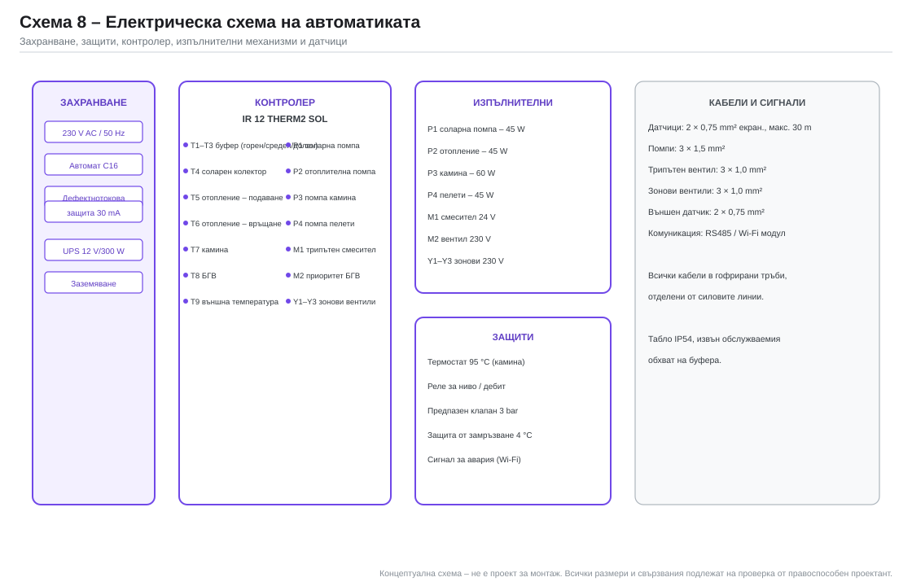
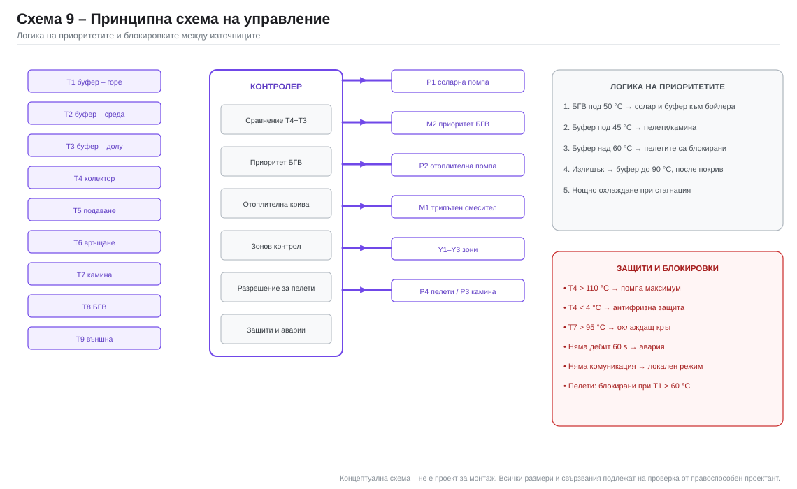

# 8. Автоматика и управление

## 8.1. Избор на контролер

**Regulus IR 12 THERM2 SOL** – един контролер за соларния кръг, два смесени
отоплителни кръга, БГВ и управление на котел/камина.

| Параметър | Стойност |
|---|---|
| Входове | 9 температурни датчика, 1 налягане, 2 безпотенциални |
| Изходи | 4 помпи, 2 смесителни вентила (0–10 V / 3 точки), 3 зонови вентила |
| Функции | солар с приоритет на БГВ, отоплителна крива, легионела, стагнация |
| Комуникация | Wi-Fi / RS485, отдалечен достъп |
| Цена (ориентир) | ≈ 620 € с комплекта датчици |

Източник: [regulus.eu – IR 12 THERM2 SOL](https://www.regulus.eu/en/ir-12-therm2-sol-smart-controller.12789),
проверено 05.11.2026.

> Ако се избере друг контролер, той трябва да има минимум **6 релейни изхода**,
> **2 смесителни изхода** и функция „солар с приоритет на БГВ“.

## 8.2. Датчици и тагове

| Таг | Място | Тип | Функция |
|---|---|---|---|
| T1 | Буфер – горна част (1 450 mm) | PT1000 / NTC | приоритет, разрешение за пелети |
| T2 | Буфер – среда (900 mm) | PT1000 | стратификация, диагностика |
| T3 | Буфер – долна част (250 mm) | PT1000 | управление на соларната помпа |
| T4 | Колекторно поле (на изхода) | PT1000, до 150 °C | управление и защита |
| T5 | Отопление – подаване | PT1000 | отоплителна крива |
| T6 | Отопление – връщане | PT1000 | баланс, диагностика |
| T7 | Камина – подаване | PT1000, до 120 °C | защита от прегряване |
| T8 | Бойлер БГВ | PT1000 | приоритет, легионела |
| T9 | Външна стена (север) | PT1000 | отоплителна крива |

Допълнително: реле за дебит на соларния кръг, пресостат (по избор),
термостат 95 °C на камината (твърдо свързан, независим от контролера).

## 8.3. Логика на соларния кръг

```
ВКЛ:  T4 − T3 > 6 K   И   T1 < 93 °C
ИЗКЛ: T4 − T3 < 3 K   ИЛИ  T1 ≥ 95 °C
```

Хистерезис 3 K предотвратява честото превключване. Помпата работи с
минимални обороти 30 % и се увеличава пропорционално на ΔT.

**Приоритет на БГВ:** ако `T8 < 52 °C` и `T4 > T8 + 7 K`, трипътният вентил M2
насочва соларния кръг към серпентина 1. Когато бойлерът достигне 57 °C,
кръгът се връща към буфера.

## 8.4. Логика на отоплението

Отоплителна крива (задава се в контролера):

| T_външна | T_подаване |
|---|---|
| +15 °C | 30 °C |
| +10 °C | 35 °C |
| +5 °C | 42 °C |
| 0 °C | 48 °C |
| −5 °C | 52 °C |
| −15 °C | 55 °C |

- Трипътният вентил M1 работи като **PI регулатор** с период 120 s.
- Помпата P2 работи, когато има заявка от стаен термостат и `T1 > 40 °C`.
- При `T1 < 40 °C` помпата спира и контролерът разрешава пелетите/камината.
- Зоновите вентили Y1–Y3 се управляват от стайните термостати (или по
  програма).

## 8.5. Логика на пелетите и камината

| Условие | Действие |
|---|---|
| `T1 < 45 °C` за 30 min и има отоплителна заявка | разрешаване на пелетите |
| `T1 > 60 °C` | блокиране на пелетите |
| Камината е активна (`T7 > 50 °C`) | блокиране на пелетите |
| Соларен кръг активен (`T4 − T3 > 3 K`) | изчакване 20 min |
| `T7 > 95 °C` | аварийно охлаждане, спиране на помпата P3 |

## 8.6. Сезонни режими

### Зима (декември–февруари)

- Слънцето загрява долната част на буфера до 30–45 °C – това е „предподгряване“.
- Отоплението работи по кривата 48–55 °C.
- Пелетите и камината покриват 75–90 % от товара.
- Приоритетът е БГВ сутрин и вечер.

### Пролет (март–май)

- Слънцето покрива 40–90 % от товара; пелетите се включват само при 2–3
  последователни облачни дни.
- Отоплителната крива слиза до 35–42 °C.
- Започва работа на соларния кръг при по-ниска температура → по-висок КПД.

### Лято (юни–август)

- Отоплението е изключено (`T9 > 18 °C` за 24 h).
- Слънцето загрява само БГВ; излишъкът загрява буфера до 90–93 °C.
- При стагнация: помпата работи на макс, за да разсее топлината; при
  `T4 > 110 °C` – пълно спиране и защита на мембраната на съда.
- **Нощно охлаждане:** ако прогнозата е слънчева и буферът е > 85 °C, през
  нощта помпата работи и отдава топлина през колекторите (радиация към небето).

### Есен (септември–ноември)

- Соларният кръг отново захранва отоплението.
- Преходен режим: пелетите се включват при `T1 < 45 °C` за повече от 1 час.
- Проверка на гликола и на налягането преди отоплителния сезон.

## 8.7. Защити

| Защита | Условие | Действие |
|---|---|---|
| Стагнация | `T4 > 110 °C` | помпа макс → спиране; предпазен клапан 6 bar |
| Прегряване на буфера | `T1 > 90 °C` | блокиране на всички източници |
| Прегряване на камината | `T7 > 95 °C` | охлаждащ кръг, аларма |
| Замръзване | `T4 < 4 °C` | помпа ВКЛ (защита на колектора) |
| Замръзване на сградата | `T9 < 0 °C` и `T5 < 5 °C` | помпа ВКЛ |
| Няма дебит | реле за дебит 60 s | спиране на помпата, аларма |
| Няма връзка | контролер | локален режим по датчици |
| Спиране на тока | UPS | помпата на камината работи 2–4 h |
| Легионела | седмично | 65 °C за 1 h |

## 8.8. Електрическа схема



| Таг | Консуматор | Мощност | Захранване |
|---|---|---|---|
| P1 | Соларна помпа | 45 W | 230 V / UPS |
| P2 | Отоплителна помпа | 45 W | 230 V |
| P3 | Помпа на камината | 60 W | 230 V / UPS |
| P4 | Помпа на пелетите | 45 W | 230 V |
| M1 | Смесителен вентил | 8 VA | 24 V |
| M2 | Приоритетен вентил | 8 VA | 230 V |
| Y1–Y3 | Зонови вентили | 3 × 6 VA | 230 V |
| – | Контролер | 15 VA | 230 V |

Обща консумация: **≈ 250 W** при всички помпи (реално 80–150 W).
Годишна консумация на електричество: **≈ 500 kWh** (не е пренебрежима и е
включена в икономическия анализ).

## 8.9. Принципна схема на управление



Приоритети:

1. **БГВ** – винаги първа, ако `T8 < 50 °C`.
2. **Отопление** – ако има заявка и `T1 > 40 °C`.
3. **Зареждане на буфера** от слънцето – винаги, когато има излишък.
4. **Пелети/камина** – само при дефицит.
5. **Излишък** – буфер до 90 °C, после стагнация/нощно охлаждане.
