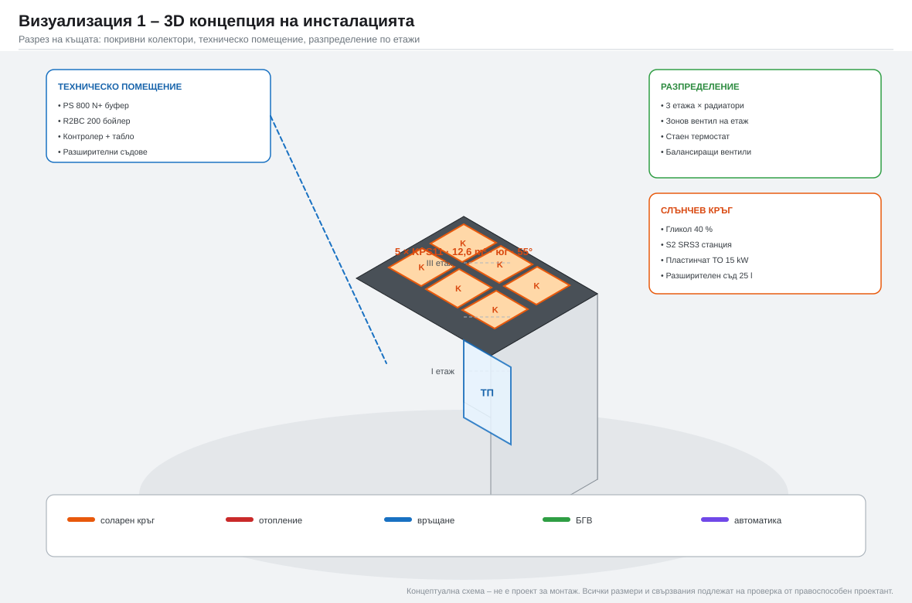
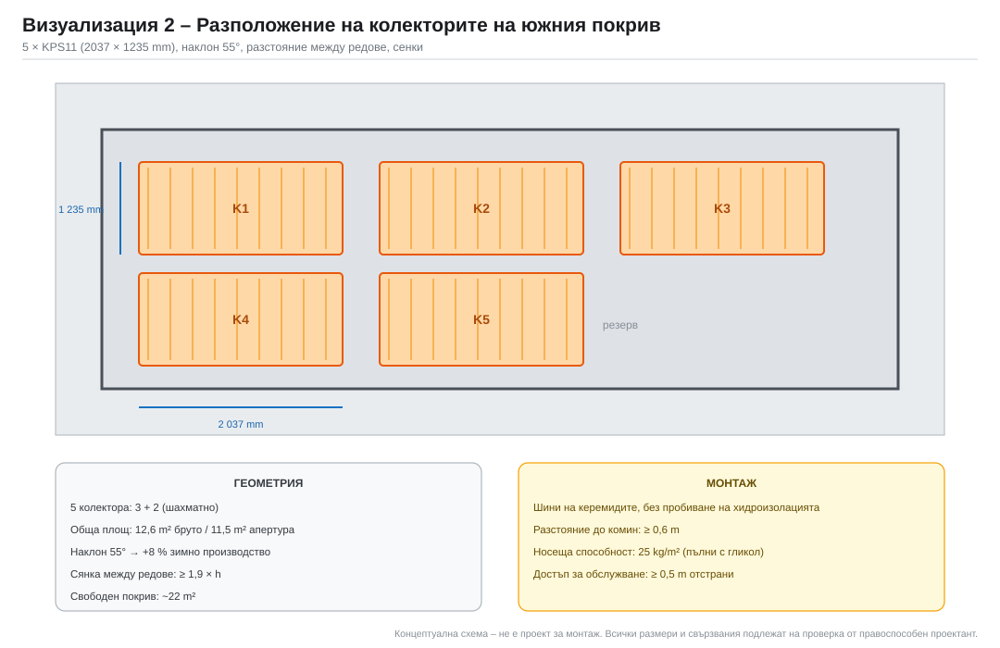
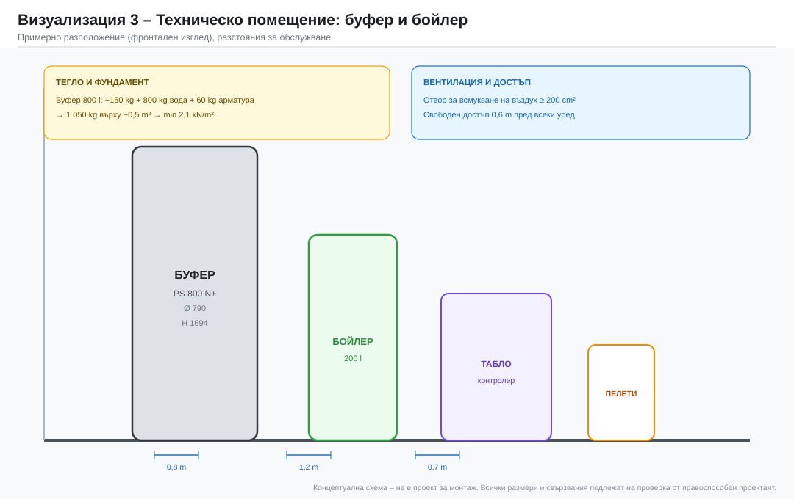
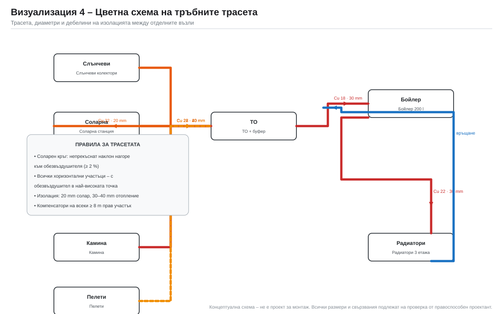
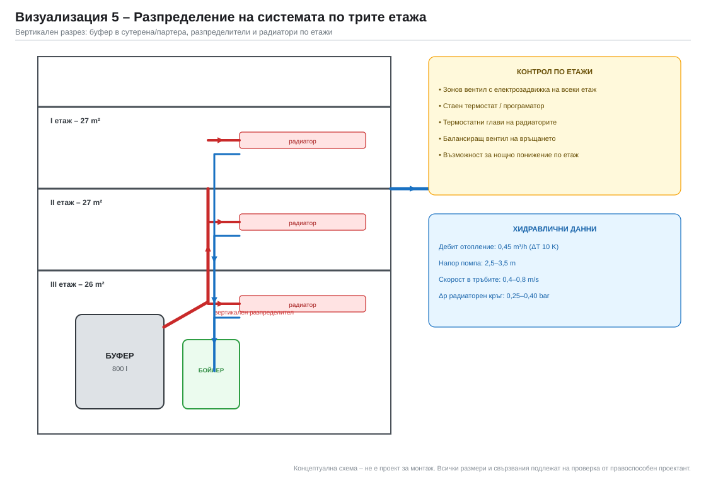
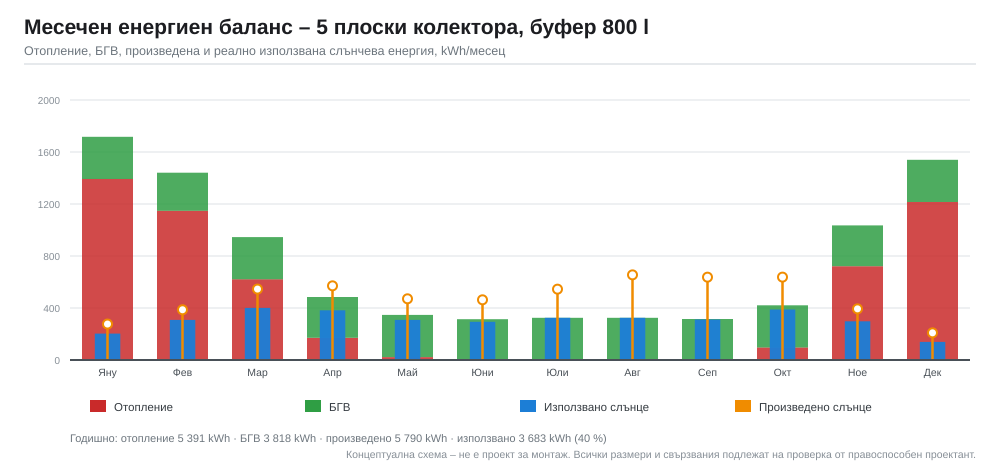

# 13. Визуализации

## 13.1. Триизмерна концепция

Покривни колектори, техническо помещение с буфер и бойлер, разпределение по
трите етажа.

## 13.2. Разположение на колекторите

## 13.3. Техническо помещение

## 13.4. Тръбни трасета

## 13.5. Разпределение по етажи

## 13.6. Месечен енергиен баланс

## 13.7. Всички инженерни схеми

| № | Схема | Файл |
|---|---|---|
| 1 | Цялостна система | [schema-01-overall.svg](images/schema-01-overall.svg) |
| 2 | Соларни колектори и соларен кръг | [schema-02-solar-loop.svg](images/schema-02-solar-loop.svg) |
| 3 | Буферен съд с всички връзки | [schema-03-buffer.svg](images/schema-03-buffer.svg) |
| 4 | Камина с водна риза | [schema-04-fireplace.svg](images/schema-04-fireplace.svg) |
| 5 | Пелетно отопление | [schema-05-pellet.svg](images/schema-05-pellet.svg) |
| 6 | Бойлер с две серпентини | [schema-06-dhw.svg](images/schema-06-dhw.svg) |
| 7 | Отоплителни кръгове за трите етажа | [schema-07-heating.svg](images/schema-07-heating.svg) |
| 8 | Електрическа схема на автоматиката | [schema-08-electrical.svg](images/schema-08-electrical.svg) |
| 9 | Принципна схема на управление | [schema-09-control.svg](images/schema-09-control.svg) |
